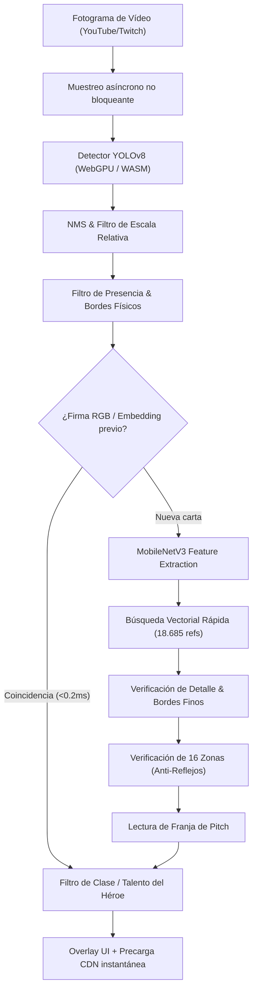

# FaB Lens 0.9.1

Extensión de Chrome para reconocer cartas de Flesh and Blood en vídeos de YouTube y Twitch en tiempo real y sin pausar la reproducción.

---

## ⚡ Novedades en 0.9.1

Esta versión culmina la reestructuración completa del motor de inferencia e interfaz con aceleración por hardware, reducción drástica de latencia y previsualización instantánea:

- **Aceleración WebGPU:** Sesiones ONNX Runtime Web (`models/card-detector.onnx` y `models/embAll2_mnv3s128.onnx`) con ejecución WebGPU nativa y *fallback* transparente a WASM multihilo.
- **Pre-indexación y ranking rápido (`rank()`):** Mapeo de 18.685 referencias a registros numéricos planos (`Float64Array` / `Int32Array`), reduciendo la búsqueda vectorial en catálogo de **218 ms a ~44 ms (4.87× más rápido)**.
- **Arranque instantáneo con filtros separables:** Indexación inicial de descriptores de detalle y reflejos mediante convoluciones separables 1D sin sobrecarga de memoria (**453 ms frente a 2.374 ms de inicialización, 5.2× más rápido**).
- **Resampleo bilineal puro en memoria:** Una única lectura en escala de grises (256×256) por orientación (`samplePatchBilinear`), eliminando más de 150 llamadas síncronas a `getImageData()` y acelerando verificaciones complejas hasta **8×**.
- **Seguimiento posicional por firma visual (<0.2 ms):** Reconocimiento inmediato de cartas desplazadas o duplicadas en mesa mediante firmas RGB y reutilización de embeddings en sesión activa.
- **Precarga proactiva de imágenes y panel persistente:** Descarga anticipada del arte de cartas identificadas desde CDN para renderizado a **0 ms** al pasar el cursor, junto a plantillas DOM reutilizadas que evitan reflows.
- **Transporte asíncrono de fotogramas:** Captura no bloqueante mediante `toBlob` / `FileReader` que reduce el tamaño del payload IPC un ~35% y mantiene la fluidez del reproductor.

---

## 🚀 Instalación

1. Descarga o clona el repositorio / descomprime el archivo `FaB-Lens-0.9.1.zip`.
2. Abre Google Chrome y navega a `chrome://extensions`.
3. Activa el **Modo de desarrollador** (esquina superior derecha).
4. Haz clic en **Cargar descomprimida** (*Load unpacked*) y selecciona esta carpeta (`FaB-Lens-0.9.1`).
5. Abre un vídeo o directo de Flesh and Blood en **YouTube** o **Twitch** (recarga la pestaña si ya estaba abierta).
6. Haz clic en el botón circular en la esquina superior derecha del reproductor de vídeo o pulsa el atajo **`Alt + Shift + F`**.

---

## 🎮 Controles y Uso

- **Pasar el ratón (Hover):** Muestra al instante la carta identificada en un recuadro blanco sobre la mesa.
- **Fijar ventana (Click):** Haz clic sobre cualquier recuadro para dejar el visor abierto.
- **Mover y redimensionar:** Arrastra la cabecera del visor para desplazarlo. Usa los botones **`+`** / **`−`** o arrastra la esquina inferior derecha para cambiar el tamaño.
- **Cerrar visor:** Pulsa la tecla **`Esc`** o el botón de cierre.
- **«¿No es esta carta?»:** Recorre alternativas visuales ordenadas por fiabilidad sin porcentajes confusos.
- **Selector de Héroes:** Pulsa **Héroes** para asignar los personajes (Izquierda/Derecha o Arriba/Abajo). Al seleccionar ambos héroes, se descartan automáticamente todas las cartas incompatibles con sus clases y talentos.
- **Nueva partida:** El botón **«Nueva partida / Reset héroes»** limpia la mesa y restablece el contexto de héroes.

---

## 📁 Estructura del Proyecto

```
FaB-Lens-0.9.1/
├── manifest.json              # Configuración de la extensión (Manifest V3)
├── background.js              # Service worker para ciclo de vida y offscreen document
├── engine.html                # Contenedor offscreen para el motor de inferencia
├── engine.js                  # Pipeline principal de inferencia, NMS y WebGPU/WASM
├── content.js                 # Content script: UI, overlay en vídeo, tracking y eventos
├── content.css                # Estilos del overlay, panel flotante y botones
├── hero-context.js            # Reglas de compatibilidad de héroes, clases y esencias
├── card-presence.js           # Filtros de presencia, bordes, contraste y escala relativa
├── card-cache.js              # Caché de firmas visuales, persistencia y deduplicación
├── catalog-cache.js           # Gestión y persistencia del catálogo en memoria
├── detail-match.js            # Verificación de bordes finos y detalles locales
├── glare-match.js             # Verificación por 16 zonas con invarianza a reflejos/brillos
├── art-outline.js             # Comparación geométrica y contraste de siluetas de arte
├── geometry.js                # Transformaciones afines, rotaciones y recortes
├── pitch.js                   # Detección y clasificación de la franja de pitch (Rojo/Amarillo/Azul)
├── help.html / help.css       # Página de ayuda y documentación de opciones
├── privacy.html               # Política de privacidad (100% local, sin telemetría)
├── THIRD-PARTY-NOTICES.txt    # Avisos legales y licencias de terceros
├── icons/                     # Iconos de extensión y botón de activación
├── models/                    # Modelos ONNX y bancos de características binarios
│   ├── card-detector.onnx     # Detector YOLOv8 (640x640)
│   ├── embAll2_mnv3s128.onnx  # Embedder MobileNetV3 (128x128)
│   ├── embeddings.bin / .json # Descriptores neuronales de 18.685 referencias
│   ├── art-detail.bin         # Descriptores de alta resolución para detail matching
│   ├── art-outline.bin / .json# Descriptores de silueta y formas del arte
│   ├── catalog-report.json    # Cobertura y procedencia del catálogo
│   └── hero-extras.json       # Definición de héroes, clases, talentos y esencias
└── vendor/
    └── ort/                   # ONNX Runtime Web (WASM + WebGPU binaries)
```

---

## 🔍 Pipeline de Reconocimiento Visual



1. **Detección de cartas:** Localización multiorientación con YOLOv8 a 640×640.
2. **Filtrado geométrico y de tapete:** Eliminación de ilustraciones grandes de tapetes mediante filtro de tamaño mediano relativo y continuidad de bordes.
3. **Extracción y búsqueda neuronal:** Embeddings normalizados de 128 dimensiones contra el catálogo de 18.685 referencias.
4. **Verificación de detalle y reflejos:** Validación estructural en 16 zonas con normalización local de iluminación para cartas foil o tapadas parcialmente por dados.
5. **Alineación de pitch y contexto de héroe:** Determinación del color de pitch y exclusión estricta de cartas incompatibles según las reglas oficiales de Flesh and Blood.

---

## 🔒 Privacidad

- **Procesamiento 100% en el dispositivo:** Los fotogramas del vídeo se analizan íntegramente dentro de tu navegador (en el documento *offscreen*). No se transmiten fotogramas ni datos de partidas a servidores externos.
- **Sin telemetría ni analíticas:** No existen cuentas de usuario, rastreadores ni registro de actividad.
- **Carga de imágenes de cartas:** Las imágenes de alta definición mostradas en el panel se descargan directamente desde los repositorios públicos oficiales (CDN de Legend Story Studios y repositorio de Talishar) mediante peticiones con política `no-referrer`.

---

## 📚 Fuentes y Créditos

- **Legend Story Studios:** Flesh and Blood TCG es marca registrada de Legend Story Studios. Todas las imágenes y nombres de cartas pertenecen a sus respectivos propietarios.
- **Card Vault:** https://cardvault.fabtcg.com/
- **Fabrary:** https://github.com/fabrary/cards
- **Talishar CardImages:** https://github.com/Talishar/CardImages
- **The FaB Cube:** https://github.com/the-fab-cube/flesh-and-blood-cards
- **ONNX Runtime Web:** Microsoft Corporation (Licencia MIT, incluida en [`vendor/ort/LICENSE`](file:///Users/jorgvt/Developer/FaB-Lens-0.9.1/vendor/ort/LICENSE)).

---
*FaB Lens es una herramienta comunitaria independiente sin ánimo de lucro y no está afiliada ni respaldada por Legend Story Studios, YouTube ni Twitch.*
